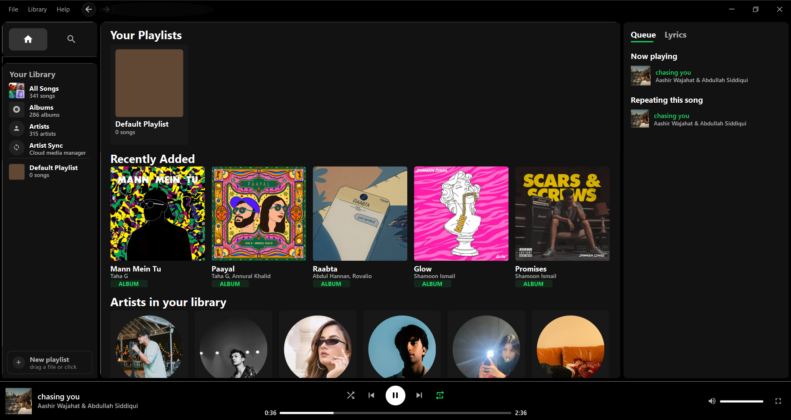
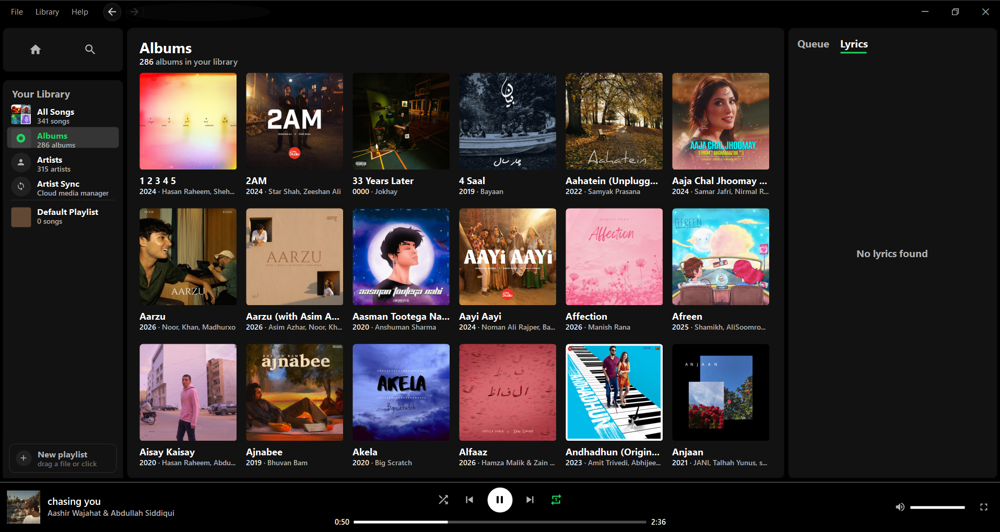
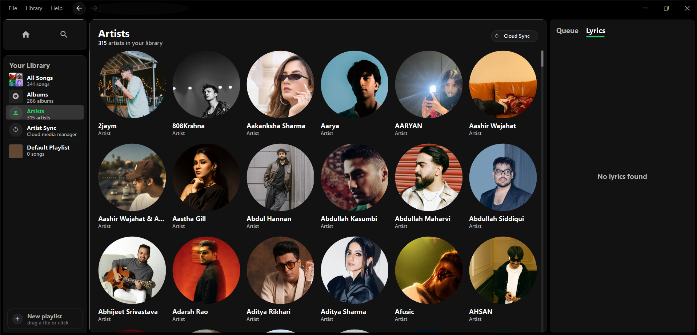

<div align="center">

# FLACify

### The Premier Lossless Music Player Experience for foobar2000

*A high-fidelity, standalone music player interface that brings the sleek aesthetic, fluid responsiveness, and rich metadata of modern Spotify desktop to your personal, offline lossless FLAC and Hi-Res collection.*

[](https://github.com/amisadman/flacify-foobar2000-theme/releases/latest)


[](LICENSE)

**Drop-in installation. No components to hunt down. No fonts to install.**



</div>

---

## Overview

**FLACify** is a premier, dark-mode desktop music player environment built specifically for music enthusiasts who curate local, bit-perfect lossless audio libraries (FLAC, ALAC, WAV, Hi-Res PCM). 

It combines the uncompromising fidelity of **foobar2000** with the clean typography, fluid animations, and visual polish of Spotify. Everything is custom-drawn with hardware-accelerated GDI+ within [Columns UI](https://github.com/reupen/columns_ui) and [JSplitter](https://hydrogenaud.io/) — featuring a custom frameless titlebar with navigation history, sticky playlist shelves, dedicated album and artist grids, rich artist profiles with verified listener metrics, custom playlist cover art pickers, a Lossless stream badge, real-time synced lyrics, and native vector barcode rendering.

> **Privacy & Offline First**: FLACify plays exclusively your local music files on disk. It requires no accounts, no subscriptions, has zero telemetry, and operates 100% offline once artist photos are cached.

---

## Perfect Companion for SpotiFLAC

If you build your local high-resolution lossless music library using **[SpotiFLAC](https://github.com/afkarxyz/SpotiFLAC)**, **FLACify is the ultimate playback frontend**:

* **Curate with SpotiFLAC**: Download your favorite tracks, albums, and playlists in bit-perfect 16-bit / 24-bit lossless FLAC.
* **Experience with FLACify**: Point foobar2000 to your download folder to enjoy an identical, familiar desktop interface with zero streaming compression, zero playback delay, and pristine audio output.

---

## Feature Showcase

### 💎 Audiophile Lossless Engine
* **Bit-Perfect Playback**: Native high-performance decoding for FLAC, ALAC, WAV, AIFF, and DSD with zero resampling artifacts.
* **Live Lossless & Hi-Res Badge**: Live stream quality badge on the playback bar (Lossless, Hi-Res Audio, 24-bit/96kHz, etc.) that instantly opens full technical credits on click.
* **Live TT Dynamic Range (DR) Meter**: Real-time official TT Dynamic Range score computation ($DR = \text{round}(20\log_{10}(\text{Peak}) - \text{Gain})$) with color-coded badges (`DR12+` Audiophile Green, `DR8-11` Amber, `DR<8` Crimson) and interactive loudness metadata popover.
* **1-Click Audio Output Switcher**: Instant switching between connected audio endpoints (Default, Realtek Speakers, External USB DAC, WASAPI Exclusive, ASIO Drivers) directly from the player bar without interrupting playback.
* **Parametric EQ Preset Visualizer**: 10-band GDI+ spline curve visualizer ($31\text{Hz}$ to $16\text{kHz}$) with quick toggles for Flat, Bass Boost, Vocal Clarity, Harman Target Curve, and Treble Air presets.
* **Comprehensive Song Details Modal**: In-depth audio specs (codec, sample rate, bit depth, bitrate, MD5 checksum), catalog tags, ISRC, copyright information, embedded lyrics, and an interactive native vector **EAN-13 & Code-128 barcode**.

### 🎨 Dynamic Ambient Color Glow & Accent Themes
* **GDI+ Palette Extractor**: Dynamically extracts dominant accent colors from currently playing album art (`img.GetColourScheme(2)`) with HSL lightness clamping ($0.14 \le L \le 0.32$).
* **60 FPS Cubic Eased Transitions**: Smooth 450ms color cross-fading on track transitions with automatic timer idling (0% CPU when stable).
* **Ambient UI Tints**: Subtle glow on the top hero banner, player bar edge, and soft layered aura halo behind the 250px artwork.
* **Theme Accent Selector**: Switch FLACify between **Spotify Green**, **Midnight Purple**, **Sunset Amber**, **Cyberpunk Cyan**, **Monochrome Slate**, or **Adaptive Album Art** directly from the title bar menu.

### 🎲 Offline Algorithmic "Daily Mixes" & Smart Playlists
* **Offline JScript Clustering Engine**: Vectorizes tracks by genre tags, artist associations, and temporal metadata to cluster your local library into 4 cohesive Daily Mixes (*Rock/Alt*, *Pop/Electronic*, *Chill/Acoustic*, *Jazz/Classical*) with 24-hour cache TTL (`cache/daily_mixes.json`).
* **Auto-Generated 2×2 Mosaic Covers**: High-cohesion cover composites generated from distinctive albums within each cluster.
* **Lossless Smart Vaults**: Instant automated playlists for *💎 24-bit Hi-Res Vault* ($\ge 24$-bit / $\ge 88.2\text{kHz}$ / DSD), *🕒 Forgotten Gems*, and *🔥 Heavy Rotation*.

### 📊 FLACify "Wrapped" & Personal Listening Analytics
* **Year-Round Telemetry Dashboard**: Dedicated Analytics page with 100% offline playback metrics.
* **GitHub-Style 52-Week Listening Heatmap**: 52 columns $\times$ 7 rows activity calendar with interactive daily tooltips and listening intensity gradations.
* **Top Artists & Albums Podium**: Visual Olympic-style podium (#1 Gold, #2 Silver, #3 Bronze) with instant artist page navigation.
* **Audiophile Fidelity Spectrum Donut Chart**: Vector arc chart illustrating listening purity (Studio Master Hi-Res vs CD Lossless FLAC vs Compressed Lossy).
* **1-Click 1080×1920 Story Card Exporter**: High-resolution Instagram/Discord story card exported directly to `%USERPROFILE%\Pictures\` with toast notification.

### 🎵 Modern Spotify-Style Desktop Experience
* **Desktop Navigation Stack**: Real browser-style navigation history with enlarged 28px circular arrow buttons (`←` / `→`) in the custom titlebar.
* **Sticky Playlist Shelves**: Pinned horizontal playlist carousels with dynamic 2×2 cover art mosaics.
* **60 FPS Eased Kinetic Scrolling**: Silky smooth scrolling physics across all lists and grids.
* **Interactive Playback Bar**: Seek bar with precise buffering, volume slider, track metadata, and quick controls.

### 💜 Liked Songs & Quick Playlist Management
* **Heart Button**: Instant one-click song liking on the player bar, playlist rows, and Listening History with persistent state.
* **Spotify-Style Plus (`+`) Button**: Tap `+` on the player bar or track menus to open an interactive popover drawer with real-time vector checkmarks (`✔`), allowing instant adding/removing across multiple playlists with a single click.
* **Dedicated Liked Songs View**: Pinned access to your complete library of favorite tracks.

### 🎨 Custom Playlist Cover Art
* **Photo Picker Overlay**: Hover over any playlist header to reveal the `[ Choose photo ]` button.
* **Native File Picker Dialog**: Pick any custom image (`.jpg`, `.png`, `.webp`) from your PC with high-quality square aspect-fill cropping.
* **Context Menu Support**: Right-click any playlist to choose *"Change cover photo..."* or *"Remove custom cover"*.

### 🕒 Listening History & Recently Played
* **Playback Event Logger**: Automatic background tracking of songs you actually listen to, persisted in `cache/history.json`.
* **Recently Played Shelf**: Interactive horizontal shelf right on the Home screen with instant one-click hover play buttons.
* **Dedicated History Page**: Full chronological replay log with relative timestamps (*"Just now"*, *"15m ago"*, *"Yesterday"*), inline cover art, and song details.

### 🎙️ Rich Artist Profiles & Artist Studio
* **Verified Artist Profiles**: Displays official Spotify photography, verified monthly listeners, formatted biographies, top 5 popular tracks table with relative play count meter bars, and categorized discography shelves (Albums, Singles & EPs).
* **Multi-Artist Parsing**: Splits collaborating artists into individual clickable links.
* **Artist Profile Studio**: Hover over any artist avatar to reveal the **[ Change photo ]** button or click **[ Edit Profile ]** to launch the in-theme Studio modal. Customize artist portraits with high-res file picker cropping, update monthly listener badges, and edit artist biographies. Customizations are permanently protected with `"isCustom": true` against background sync overwrites.
* **Artist Cloud Sync**: Built-in background sync manager powered by Spotify Web Scraper GraphQL and Deezer HD APIs. Downloads official high-res portraits and bio summaries directly to your local cache with zero API keys. 100% offline once downloaded.

### 🔍 Inline Tracklist Quick Filter (`Ctrl+F`)
* **Live In-Place Row Filtering**: Press `Ctrl+F` (or click the magnifying glass icon) in any Playlist, Album, or All Songs view to reveal a Spotify-style filter bar.
* **Instant Substring Search**: Type to filter visible tracks in real time by title, artist, or album name.
* **Match Count Badge**: Live counter displays matching count (e.g. `12 of 84 tracks`).
* **Quick Dismissal**: Press `Escape` to clear text or close the filter bar.

### ⏱️ Smart Sleep Timer with Smooth Volume Fade
* **Sleep Timer Control**: Discreet `timer` / `moon` icon in the playback bar.
* **Flexible Durations**: Choose between **15 minutes**, **30 minutes**, **45 minutes**, **1 hour**, or **End of current track**.
* **Live Countdown Badge**: Active countdown is displayed as an ambient glowing green badge (e.g. `🌙 28m` or `🌙 Track end`).
* **Gentle Volume Fade-Out**: Attenuates volume smoothly over 5 seconds before pausing playback, preserving your volume setting for your next listen.

### 🔊 Intuitive Audio Controls
* **Speaker Click-to-Mute**: Click the speaker icon to instantly mute playback; click again to restore your exact previous volume.
* **Dynamic Mute Icon**: Switches to a red-accented `volumeMute` speaker icon when muted and zeroes out the volume slider.
* **ReplayGain Loudness Normalization**: One-click ReplayGain loudness matching for smooth volume across albums.

### 🌌 Fullscreen Mode & Real-Time FFT Visualizers
* **Immersive Fullscreen**: Clean, distraction-free view with large cover art, track credits, and player controls.
* **Rolling Synced Lyrics**: Real-time synchronized scrolling lyrics from embedded tags or `.lrc` files.
* **4 FFT Audio Visualizers**: Real-time PCM spectrum analyzers (bars, peaks, wave, and chill modes).

---

## Screenshot Gallery

### Library & Browsing
<table>
<tr>
<td width="50%"><br><sub><b>Dedicated Albums Grid (Release Years & Track Counts)</b></sub></td>
<td width="50%"><br><sub><b>Dedicated Artists Grid (Circular High-Res Avatars)</b></sub></td>
</tr>
<tr>
<td><br><sub><b>Playlist View with Adaptive Artwork Color Gradient</b></sub></td>
<td><br><sub><b>All Songs Virtualized List (Instant 60fps Scrolling)</b></sub></td>
</tr>
<tr>
<td><br><sub><b>Instant Search Across Tracks, Artists & Albums</b></sub></td>
<td><br><sub><b>Artist Cloud Sync (Spotify GraphQL & Deezer HD)</b></sub></td>
</tr>
</table>

### Album & Artist Experience
<table>
<tr>
<td width="50%"><br><sub><b>Album Details (Action Bar & Track Table)</b></sub></td>
<td width="50%"><br><sub><b>Album Details (Artist Spotlight & More Releases)</b></sub></td>
</tr>
<tr>
<td><br><sub><b>Artist Profile (Verified Listeners & Popular Tracks)</b></sub></td>
<td><br><sub><b>Artist Discography (Categorized Shelves & Bio)</b></sub></td>
</tr>
</table>

### Lossless Details & Fullscreen
<table>
<tr>
<td width="50%"><br><sub><b>Song Details (Audio Specs & Native Vector Barcode)</b></sub></td>
<td width="50%"><br><sub><b>Fullscreen Now Playing View</b></sub></td>
</tr>
<tr>
<td><br><sub><b>Fullscreen Rolling Synced Lyrics</b></sub></td>
<td><br><sub><b>Fullscreen Real-Time FFT Visualizer (4 Styles)</b></sub></td>
</tr>
</table>

---

## Installation

### Method 1: Fresh Portable Install (Recommended)

1. Download and run the **foobar2000 v2 (64-bit)** installer from the [official website](https://www.foobar2000.org/download). During installation, choose **Portable mode** and select a folder (e.g. `C:\Music\foobar2000` or `D:\foobar2000`).
2. Download **`FLACify-v1.5.3.zip`** from the **[latest release](https://github.com/amisadman/flacify-foobar2000-theme/releases/latest)**.
3. Extract the **`profile`** folder from the zip directly into your foobar2000 directory (the folder where `foobar2000.exe` resides).
4. Launch foobar2000. Under **Preferences → Media Library**, add your music folder (e.g. your SpotiFLAC downloads).

> **Zero hassle**: Columns UI, JSplitter, and UI Wizard are already pre-configured. **No fonts to install**: FLACify renders with native Windows Segoe UI and Segoe MDL2 Assets.

### Method 2: Existing foobar2000 Setup

1. Close foobar2000.
2. Download and extract **`FLACify-v1.5.3.zip`**.
3. Double-click **`install.bat`** in the repository/extracted folder. The installer automatically backs up your previous configuration to `<profile>\flacify-backup\<date>\` before applying FLACify.
4. Launch foobar2000.

### ⚠️ Windows 11 Troubleshooting: Smart App Control / Application Control Policy

If foobar2000 displays the following dialog on startup:
```text
Failed to load component: ...\foo_uie_jsplitter\foo_uie_jsplitter.dll
Reason: An Application Control policy has blocked this file.
```

**Root Cause**: Windows 11 Smart App Control (SAC) blocks community open-source plugins (`foo_uie_jsplitter.dll`, `foo_ui_columns.dll`) because they do not have expensive commercial Authenticode EV certificates.

**Resolution Steps**:
1. Open **Windows Security** (press <kbd>Win</kbd> and search for *Windows Security*).
2. Click **App & browser control** > **Smart App Control settings**.
3. Set Smart App Control to **Evaluation** or **Off**.
4. If the downloaded archive has Windows "Mark of the Web", right-click the zip before extracting > **Properties** > check **Unblock** > **Apply** (or run `Unblock-File -Path "<foobar2000-path>\profile\user-components-x64\foo_uie_jsplitter\*.dll"` in PowerShell).

---

## Syncing Artist Photos & Monthly Listeners

FLACify features an automated, offline-first artist sync pipeline:

1. Click **Artist Sync** in the left sidebar (or click the **[ ☁ Cloud Sync ]** button on the Artists grid).
2. Click **Fetch Missing** (or run `tools/sync_artists.ps1` in PowerShell).
3. FLACify connects to the anonymous Spotify Web Scraper GraphQL endpoint, fetches official high-res artist avatars, verified monthly listener counts, and biography summaries, crops them into 1:1 squares, and saves them locally in `cache/artists/`.
4. Once downloaded, all metadata and artwork run **100% offline**.

---

## Credits & Acknowledgments

FLACify is built with gratitude to the open-source foobar2000 and audiophile communities:

* **[superziper](https://github.com/superziper)** — Creator of the original **[Verdant](https://github.com/superziper/verdant-foobar2000-theme)** theme, whose architecture served as the foundation for this project.
* **[afkarxyz](https://github.com/afkarxyz)** — Creator of **[SpotiFLAC](https://github.com/afkarxyz/SpotiFLAC)**, the premier tool for building pristine lossless music collections.
* **Reupen Shah** — Author of [Columns UI](https://github.com/reupen/columns_ui).
* **LUR** — Author of **JSplitter** (`foo_uie_jsplitter`).
* **The Wizardium** — Author of [UI Wizard](https://github.com/The-Wizardium/UI-Wizard).

---

## License & Disclaimer

* FLACify theme scripts and customizations are licensed under the [MIT License](LICENSE).
* Bundled components retain their original licenses (Columns UI: LGPL-3.0, UI Wizard: MIT).
* **Disclaimer**: FLACify is an independent open-source music player interface for personal offline audio playback. It is not affiliated with, sponsored by, or endorsed by Spotify AB. "Spotify" is a registered trademark of Spotify AB.
