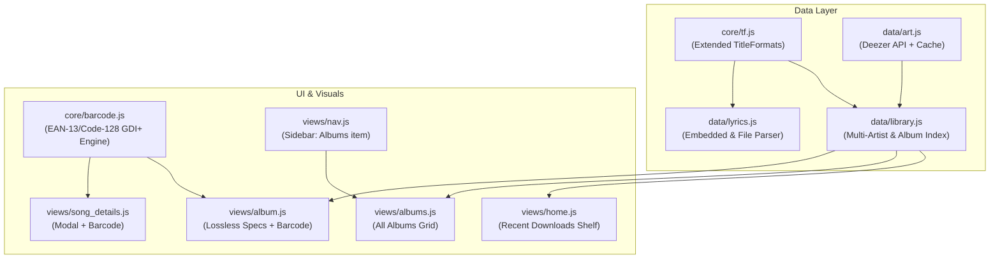

# Verdant Theme Customization & Lossless Library Plan

This document outlines the architecture, data structures, and phased implementation for customizing the **Verdant** foobar2000 theme to support an offline lossless music library with Spotify-grade visual polish.

---

## 1. Metadata Mapping

Based on the metadata extracted from `Since Tum - JANI, Talha Anjum, superdupersultan.flac.HTML`:

| Visual Component | Tag / Technical Source | Format / Example Value |
|---|---|---|
| **Multiple Artists** | `%performer%` / `%artist%` / `%album artist%` | `JANI, Talha Anjum, superdupersultan` |
| **Album Title** | `%album%` | `Since Tum` |
| **Barcode** | `%barcode%` / `%upc%` / `%ean%` | `5063549921583` (EAN-13) |
| **Copyright Notice** | `%copyright%` | `2024 rearts records` |
| **Embedded Lyrics** | `%lyrics%` / `%unsyncedlyrics%` / `%unsynced lyrics%` | Vorbis comment with synced/unsynced text |
| **Audio Specs** | `$info(codec)`, `$info(bitrate)`, `$info(bitspersample)`, `$info(samplerate)` | `FLAC` · `1 625 kbps` · `24-bit` · `48.0 kHz` |
| **Release & Track Identifiers** | `%isrc%`, `%genre%`, `%date%`, `%comment%` | `AUBEC2482091` · `Rap/Hip Hop` · `2024-09-25` · Spotify URL |
| **Recent Downloads** | `%added%` / `%last_modified%` | File system timestamp for newly added files |

---

## 2. Architecture & Data Flow



---

## 3. Phased Implementation Breakdown

### Phase 1: Core TitleFormat & Lyrics Engine
> [!IMPORTANT]
> Embedded lyrics in FLAC files are stored in Vorbis comments (`LYRICS` or `UNSYNCEDLYRICS`). The theme currently only checks disk files (`.lrc`/`.txt`).

1. **TitleFormat Extensions** in [core/tf.js](file:///d:/Coding/!Git/verdant-foobar2000-theme/theme/verdant/core/tf.js):
   - Add TitleFormats for:
     - `barcode`: `[$meta(barcode)][$meta(upc)][$meta(ean)]`
     - `copyright`: `[$meta(copyright)]`
     - `isrc`: `[$meta(isrc)]`
     - `lyrics`: `[$meta(lyrics)][$meta(unsyncedlyrics)][$meta(unsynced lyrics)]`
     - `codec`: `$info(codec)`
     - `bitrate`: `$info(bitrate)`
     - `bitdepth`: `$info(bitspersample)`
     - `samplerate`: `$info(samplerate)`
     - `lastMod`: `[$if2(%added%,%last_modified%)]`
     - `comment`: `[$meta(comment)]`
     - `producer`: `[$meta(producer)]`

2. **Embedded Lyrics Support** in [data/lyrics.js](file:///d:/Coding/!Git/verdant-foobar2000-theme/theme/verdant/data/lyrics.js):
   - Update `loadLyrics()`:
     - Read embedded lyrics tag via `TF.lyrics.EvalWithMetadb(NP)`.
     - Fall back to reading `.lrc` and `.txt` files beside the audio track if the tag is empty.
     - Normalize slash-separated tags (` / `) to newlines if present.
     - Pass text to `parseLyrics(text)`:
       - If timestamp headers `[mm:ss.xx]` are found: set `synced: true`, triggering Verdant's smooth 60fps rolling lyric animation.
       - If no timestamps exist: set `synced: false`, displaying static lyrics with mouse-wheel scrolling.

---

### Phase 2: Vector Barcode Engine (GDI+)
> [!TIP]
> A dedicated barcode generator draws true-to-scale vector bars directly to GDI+ without external image dependencies or web services.

1. **New File**: `theme/verdant/core/barcode.js`
   - Encodes standard **EAN-13** barcodes (such as `5063549921583`):
     - First digit parity selector for Left Hand A & B patterns.
     - Right Hand C pattern.
     - Guard bars: Start (`101`), Center (`01010`), End (`101`).
     - Total 95 binary modules.
   - Fallback generator for Code-128 / UPC if string length differs.
   - Drawing function:
     ```javascript
     function drawBarcode(gr, x, y, w, h, barcodeStr, textColor)
     ```
     - Draws crisp black/white stripes using `gr.FillSolidRect`.
     - Draws the formatted human-readable digit string cleanly centered below the bars.

---

### Phase 3: Multi-Artist Extraction & 3rd-Party Image Fetcher

1. **Multi-Artist Split** in [data/library.js](file:///d:/Coding/!Git/verdant-foobar2000-theme/theme/verdant/data/library.js):
   - Update `getArtistList()`:
     - Split strings matching `/\s*,\s*|\s*;\s*|\s+feat\.\s+|\s+ft\.\s+/i`.
     - Example: `"JANI, Talha Anjum, superdupersultan"` splits into three distinct artists:
       - **JANI**
       - **Talha Anjum**
       - **superdupersultan**
     - Map each individual artist to every track they feature on in `artistTracksMap`.
     - Clicking on an individual artist opens their artist page, listing their discography and featuring songs, playable with a single click.

2. **3rd-Party Artist Image Integration** in [data/art.js](file:///d:/Coding/!Git/verdant-foobar2000-theme/theme/verdant/data/art.js):
   - Use `utils.HTTPRequestAsync` / `utils.DownloadFileAsync` to query the Deezer Open API:
     - Endpoint: `https://api.deezer.com/search/artist?q={name}` (Free, no API key required, high-resolution circular portraits).
     - Cache image to `<profile>\verdant\cache\artists\<hash>.jpg`.
     - Load via `gdi.Image(cachePath)` with fallback to the local album art / initials avatar if offline.

---

### Phase 4: Albums Grid & Album Details View

1. **Library Album Indexing** in [data/library.js](file:///d:/Coding/!Git/verdant-foobar2000-theme/theme/verdant/data/library.js):
   - Maintain `getAlbumList()`:
     - Aggregates tracks by `album + album artist`.
     - Captures representative cover handle, year, track count, total duration, technical audio specs, barcode, and copyright.

2. **Albums Grid View** (`theme/verdant/views/albums.js`):
   - Spotify-style grid of square album cards with high-res cover art, album title, artist, and year.
   - Smooth mouse-wheel scrolling and responsive layout.

3. **Album Details Page** (`theme/verdant/views/album.js`):
   - **Header**: Dynamic tinted gradient extracted from the album artwork, album title, artist list, release date, track count, total runtime.
   - **Lossless Audio Specs Badge**:
     - Modern pill badge: `FLAC · 24-bit / 48.0 kHz · 1625 kbps` (Hi-Res Lossless badge styling).
   - **Tracklist**:
     - Numbered rows, play buttons, song titles, track duration.
     - Double-click to play; click play icon on hover.
   - **Spotify-Style Footer**:
     - Release date (e.g., `September 25, 2024`).
     - Copyright notices: `© 2024 rearts records` · `℗ 2024 rearts records`.
     - **Rendered Barcode**: Visual vector barcode generated via `drawBarcode(...)` with the barcode number below it.

---

### Phase 5: Home Screen "Recently Downloaded" Shelf

1. **Recently Added Tracker** in [data/library.js](file:///d:/Coding/!Git/verdant-foobar2000-theme/theme/verdant/data/library.js):
   - Extract the 5 most recently added/modified songs based on `TF.lastMod`.

2. **Home View Update** in [views/home.js](file:///d:/Coding/!Git/verdant-foobar2000-theme/theme/verdant/views/home.js):
   - Insert a horizontal **"Recently Added" / "Latest Releases"** shelf right above "Artists in your library".
   - Include a Spotify-style **New Release** card:
     - Displays cover art, track title, artist, and an "ALBUM" pill.
     - Clicking the card or button navigates directly to that Album Details page.

---

### Phase 6: Song Details Page & Left Navigation Integration

1. **Song Details Modal / View** (`theme/verdant/views/song_details.js`):
   - Opened via track context menu ("Song Details / Credits") or clicking details icon.
   - Displays:
     - High-res cover art, track title, clickable artist tags, album title.
     - Technical specifications: Codec (`FLAC`), Bit depth (`24-bit`), Sample rate (`48.0 kHz`), Bitrate (`1625 kbps`), Channel layout (`2 channels / Stereo`).
     - Metadata & Credits: ISRC (`AUBEC2482091`), Producer (`rearts records`), Copyright (`2024 rearts records`), Spotify link (`https://open.spotify.com/album/...`).
     - Rendered vector barcode.

2. **Sidebar Navigation Update** in [views/nav.js](file:///d:/Coding/!Git/verdant-foobar2000-theme/theme/verdant/views/nav.js):
   - In the pinned "Your Library" card, add an **Albums** row beside "All Songs".
   - Clicking "Albums" switches `view = 'albums'` to show all library albums.

3. **Master Wiring** in [app.js](file:///d:/Coding/!Git/verdant-foobar2000-theme/theme/verdant/app.js) and [main.js](file:///d:/Coding/!Git/verdant-foobar2000-theme/theme/verdant/main.js):
   - Include new modules in `main.js`: `core/barcode.js`, `views/albums.js`, `views/album.js`, `views/song_details.js`.
   - Wire input handlers (clicks, hovers, scroll) in `app.js` for the new views and modals.

---

## 4. Verification & Testing Checklist

- [ ] **Barcode Accuracy**: Test with `5063549921583` and verify correct guard and data bars render.
- [ ] **Lyrics Sync**: Verify both synced and unsynced embedded lyrics from sample FLAC tags display properly in the Lyrics tab.
- [ ] **Artist Separation**: Ensure `"JANI, Talha Anjum, superdupersultan"` appears as 3 distinct artists on Home and Library.
- [ ] **Album View**: Verify bitrate, bit depth (`24 bits`), sampling rate (`48.0 kHz`), copyright notice, and barcode show on the album page.
- [ ] **Home Shelf**: Confirm the top 5 newest downloaded items display on Home and take the user to the album.
- [ ] **Performance & Memory**: Ensure adaptive caching in `core/memory.js` keeps memory comfortably within the 420MB–900MB budget.
